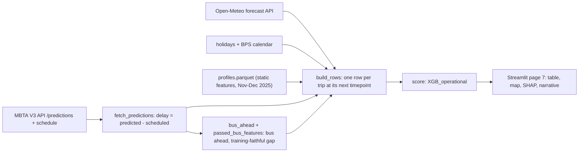

# Chapter 8 — Live Mode (Phase 7)

## 8.1 What
Live mode scores MBTA buses **that are running right now** with the operational XGBoost model and explains each
prediction (SHAP + narrative). It is page **7 · Live Mode** of the dashboard and the module
[`src/live/mbta_live.py`](../src/live/mbta_live.py).

## 8.2 Why
Everything up to Phase 6 is evaluated on historical data (Nov–Dec 2025 test set). A transit agency, however, needs
the model *in the loop*: a dispatcher wants to know which bus on the road will be > 5 min late at its next timepoint,
and why, while there is still time to act (hold a bus, short-turn, inform riders). Live mode is the proof that the
pipeline can be fed from real-time sources with the same feature definitions used in training.

## 8.3 Architecture

| Source | Used for | Key needed | Limit |
|---|---|---|---|
| MBTA V3 `/predictions?include=schedule` | predicted vs scheduled time per upcoming stop | optional (`MBTA_API_KEY`) | 20 req/min without key, 1000/min with |
| MBTA V3 `/routes/{id}` | direction names (Outbound/Inbound) | optional | same |
| Open-Meteo forecast | precipitation, temperature, wind, snow | none | generous |
| `holidays` + BPS calendar | holiday / school day flags | none | offline |
| `reports/app/profiles.parquet` | history rates, GTFS segment, ridership, stop position | none | offline |

## 8.4 How a live feature row is built
The operational model was trained to answer: *given how late the bus was at the previous timepoint, will it be
> 5 min late at this timepoint?* Live mode reproduces that question as faithfully as possible:

| Training feature | Live construction | Faithfulness |
|---|---|---|
| `prev_tp_delay` | current delay = MBTA predicted − scheduled at the trip's next stop | good (MBTA's own estimate) |
| `min_since_prev_tp` | scheduled time at next timepoint − now, **not clipped** (negative = already behind schedule) | approximation: departure from the previous TP is ≤ now, so this is a lower bound of the training value |
| `prev_bus_delay`, `prev_bus_gap_ratio` | `passed_bus_features()`: walk the buses ahead (nearest first, gaps from `bus_ahead()`), skip any that still predict our target stop, take the first that has passed it; passing time ≈ our ETA − gap; ratio = (now − passing time) / planned headway | same definition as training (decision 30); passing time estimated |
| `start_delay` | set equal to current delay | approximation (unknown live) |
| weather | Open-Meteo current hour, same units as training | good |
| calendar, daylight | computed for "now" | good (school calendar only to June 2026) |
| history, GTFS, ridership, position | median per route × direction × stop × hour × weekend from Nov–Dec 2025 | good while schedules are unchanged |
| events | set to 0 | limitation (no free live events feed) |

**Decision D24 — score only the next timepoint.** The model never saw a gap of several timepoints between the known
delay and the target, so scoring timepoints further ahead would be extrapolation. Further timepoints are shown with
MBTA's own prediction, clearly labelled.

**Decision D26 — score only buses in service, with a schedule.** Trips whose next stop is stop_sequence 1 have not
left the terminal (MBTA copies the schedule, so their "delay" is 0 and the slack was 15–58 min, never seen in
training), and added "-OL" trips have no schedule, so their delay is undefined. Both are skipped and counted in the
status line.

**Decision D25 — bus-ahead gap at the first common stop.** Live, the leading bus has usually already passed our next
stop, so "same stop" is impossible; the first stop both trips still predict is the closest measurable equivalent.

**Decision 30 — rebuild the training definition of the "previous bus".** While analysing bunching (Chapter 8) we found
that the training feature is *time since the last bus that has already passed the target stop*: a leader that is still
between the two timepoints is skipped, so for a bunched pair the feature describes the bus **two** ahead and the ratio
is large (test rows with ratio > 2 are 35-36 % bunched). The first live version used the gap to the direct leader,
which is exactly backwards for bunched pairs. `passed_bus_features()` now skips leaders that still have a prediction
for our target stop. Real-API check (route 66, 8 Nov 2026 evening): a bus 2.45 min behind its leader now gets ratio
1.19 (the bus two ahead), as training would have computed; buses with no passed leader in service get NaN, which
XGBoost handles natively. Covered by `test_passed_bus_features_skips_leader_still_en_route`.

## 8.5 Error handling
Every failure returns an empty frame plus a human-readable status, never an exception:

| Situation | Message shown | Logged to |
|---|---|---|
| HTTP 429 | "MBTA API rate limit reached … add MBTA_API_KEY" | `logs/live.log` |
| HTTP 401/403 | "MBTA API rejected the key" | — |
| network error / timeout | "Cannot reach the MBTA API (…)" | `logs/live.log` |
| no buses (night) | "No live predictions for route X right now" | — |
| buses but none near a known timepoint | "… none is approaching a timepoint the model knows" | — |
| weather API down | weather assumed dry/mild, source shown as "unavailable" | `logs/live.log` |
| OpenAI key invalid / expired | warning banner, template narrative | `logs/llm.log` |

## 8.6 Results
First end-to-end run on **Sunday 8 Nov 2026, ~20:30 ET** (real MBTA API, real Open-Meteo weather: 7.7 °C, dry,
gusts 31 km/h).

**Iteration 1 (bug found).** Route 28: 13 trips scored, but 8 of them were buses still at the terminal with
`min_since_prev_tp` = 15–58 min; and `min_since_prev_tp` was clipped at 0, so a bus already behind schedule lost
that signal. A check of the test set showed that negative slack occurs in **27.5 %** of rows and is the most
informative region (late rate 57 % for −5…0 min, 99.9 % below −10 min). → Decision D26 and the unclipped feature.

**Iteration 2 (after the fix).**

| Route | Active trips | Scored (in service) | Not started | Unscheduled (-OL) | Alerts ≥ 0.50 |
|---|---|---|---|---|---|
| 28 | 14 | 6 | 8 | 0 | 1 |
| 39 | 14 | 4 | 7 | 3 | 1 |
| 66 | 16 | 7 | 9 | 0 | 3 |

Sanity checks on the 17 scored buses:

* Route 39 outbound, 23.7 min late, 18.5 min past its scheduled time → p = 1.00 (MBTA: 23.7 min).
* Route 66 outbound, 10.2 and 8.2 min late → p = 0.97 and 1.00; route 66 inbound 6.7 min late → p = 0.91.
* Route 28 outbound, 4.9 min late and 2.4 min behind schedule → p = 0.82, while MBTA predicts 4.97 min (just under
  the threshold): the model adds that there is no slack left to recover.
* Every bus with a current delay ≤ 3.3 min → p ≤ 0.02.
* All 4 buses that MBTA predicts > 5 min late are flagged (p ≥ 0.91); the only extra alert is the 4.9-min case.

This is consistent with the offline result (operational AUC 0.977) and with the P4 finding that the SHAP effect of
`prev_tp_delay` changes sign between 4 and 5 min. It is a sanity check, not an evaluation (see limitations).

**Iteration 3 (severity added).** After Phase 5 the live table also shows the expected severity class and P(> 10 min late)
from the operational 4-class model (decision 29). Route 66 at 20:57 ET: 5 buses in service, all with current delay
≤ 1 min → classes on time / minor, P(major) ≤ 0.01; one bus running 11.8 min early → on time.

Unit tests (`tests/test_app.py`) cover HTTP 429, HTTP 403, network failure, no buses, weather fallback and the
bus-ahead logic with mocked responses.

## 8.7 Limitations
1. No ground truth live: we cannot compute AUC in real time; the comparison with MBTA's own prediction is a sanity
   check, not an evaluation. A logging-and-backtest loop (store live scores, join with the next day's
   arrival-departure file) is the natural next step.
2. `start_delay` and `min_since_prev_tp` are approximations (table above).
3. Events are set to 0; the school calendar is only known to June 2026.
4. Profiles must be rebuilt (`python -m src.app_data`) when MBTA changes schedules (each "rating", ~quarterly).
5. Without an MBTA key the limit is 20 requests/min; one refresh uses 2 requests, so the optional auto-refresh runs
   every 60 s (a 10-s fragment only checks the snapshot age), leaving head-room for several users or manual refreshes.
